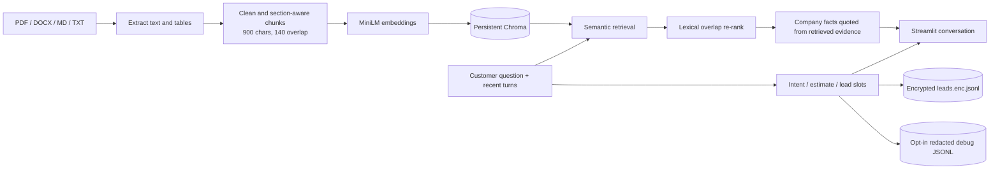

# Construction-RAG-Chatbot\n\n# BuildMate AI — Construction & Interiors Chatbot

A compact RAG chatbot for a fictional Pune-based construction and interiors company. It ingests a mixed-format knowledge base, retrieves and cites evidence, responds in the customer's English, Hindi, or Hinglish, calculates explicitly indicative package estimates, refuses unsupported scope and discount requests, and captures consented project leads in JSONL.

## Run locally

Requirements: Python 3.10 or newer (Python 3.12 is recommended for the dependency set). On first index build, `sentence-transformers` downloads `all-MiniLM-L6-v2` from Hugging Face; allow network access for that one-time model download.

```powershell
py -3.12 -m venv .venv312
.venv312\Scripts\Activate.ps1
python -m pip install -r requirements.txt
# Only run this if .env does not already exist; never overwrite your local secrets.
if (!(Test-Path .env)) { Copy-Item .env.example .env }
# Add COHERE_API_KEY to .env for answer generation (keep the key private).
# Generate a key, then paste it into LEADS_ENCRYPTION_KEY in .env:
python -c "from cryptography.fernet import Fernet; print(Fernet.generate_key().decode())"
python -m src.ingest --rebuild
streamlit run src/app.py
```

Without a Cohere key, retrieval and estimates are available but general generative answers require a configured answer provider. The embedding model runs locally. General answers use the configured LLM providers; company-specific factual answers are returned as matching sentences copied directly from the retrieved documents, so model-generated claims cannot be authorized by a filename citation alone. Greetings and thanks are answered locally without retrieval or an API request. Consented leads are Fernet-encrypted into `leads.enc.jsonl`; lead writes fail closed unless `LEADS_ENCRYPTION_KEY` is valid. The consent prompt discloses up to 180 days of retention, and expired rows are pruned at startup and at most hourly while saving leads. File writes and pruning are serialized within one app process. Back up the key securely because it is required to read the leads. Chat history/customer contact data are redacted before provider calls. Optional diagnostics store message lengths and source metadata only, never chat text or retrieved snippets. The assistant accepts messages up to 12,000 characters, applies best-effort client-IP or per-session fallback request limits, and caps simultaneous LLM calls at `MAX_CONCURRENT_LLM_REQUESTS` (default 100). Streamlit's IP value is not a security boundary; public deployments need edge rate limiting/WAF and an authenticated operational environment.

## Deploy on Streamlit Community Cloud

Community Cloud deploys from a GitHub repository; a local folder alone cannot be deployed. Create an empty repository on GitHub, then from this project folder run these commands (replace the URL with your repository URL):

```powershell
git init
git add .
git status --short  # confirm .env is not listed; .env.example is safe to publish
git commit -m "Initial BuildMate AI app"
git branch -M main
git remote add origin https://github.com/YOUR-ACCOUNT/YOUR-REPOSITORY.git
git push -u origin main
```

In Streamlit Community Cloud, choose **Create app**, select that repository and the `main` branch, and set the app file to `src/app.py`. Under the app's **Settings → Secrets**, add TOML values for `COHERE_API_KEY`, `GEMINI_API_KEY`, `HF_TOKEN`, and `LEADS_ENCRYPTION_KEY`. The HF token needs Inference Providers permission to enable the final LLM fallback; its model service may consume account credits. The app reads those Streamlit secrets as runtime configuration. Keep `.env` local and never paste it into GitHub. Community Cloud's local filesystem is ephemeral, so encrypted lead files may not survive a restart; use durable external storage before relying on it for real customer leads.

To add or edit knowledge, place PDF, DOCX, Markdown, or TXT files under `data/`, then run `python -m src.ingest` (incremental) or `python -m src.ingest --rebuild` (clean re-index). Incremental ingestion reconciles the index with the current source set, removing stale chunks from edited and deleted files. The app also checks for new source chunks on startup.

## General question fallback

Company-specific factual answers use retrieved excerpts directly. General questions try Gemini, then Cohere, then Hugging Face. Configure `GEMINI_API_KEY` and an Inference Providers-enabled `HF_TOKEN` in Streamlit Community Cloud under **Settings → Secrets**; never commit API keys to GitHub. Optional model settings are `GEMINI_MODEL` (`gemini-3.8-flash`), `GEMINI_FALLBACK_MODEL` (`gemini-3.6-flash`), `COHERE_CHAT_MODEL` (`command-r7b-12-2024`), `COHERE_FALLBACK_MODEL` (`command-a-03-2025`), and `HF_MODEL` (`Qwen/Qwen3-8B`). Answers about recent events may need web search grounding for up-to-date verification.

## Architecture



## Design decisions

- **Knowledge base:** 17 fictional-company documents across two formats: 15 PDFs totaling 30 pages, plus two operational Markdown guides. The PDFs cover the company, services, packages, rate card, brands, process, timelines, warranty, payment, FAQ, lead playbook, and three case studies, with policy edge cases. The Markdown decision register states how to resolve overlaps: current dedicated rate/policy authority beats historical case-study examples. The city and measurement guide covers useful qualification details. Together these give multiple sources, tables, and intentionally overlapping policy information.
- **Ingestion:** `pypdf` layout extraction helps retain table alignment; DOCX paragraphs and tables are read separately; Markdown/TXT preserve table rows. Cleaning removes PDF hyphenation and layout noise but preserves headings and table boundaries. Each chunk records source filename, category, and chunk index.
- **Chunking:** 900 characters with 140 characters of overlap balances focused retrieval against short policy/table fragments. Headings start new sections. Table blocks are kept together when feasible. Adjust via `.env` and rebuild the index.
- **Embeddings and vector store:** `sentence-transformers/all-MiniLM-L6-v2` generates normalized local vectors; persistent Chroma stores embeddings and source metadata. It avoids sending the company corpus to an embedding API and works for this English-dominant fictional corpus. A multilingual embedding model could improve Hinglish retrieval.
- **Retrieval:** semantic Chroma search retrieves up to four times the final top-k candidate pool. A lexical overlap score reranks candidates (72% semantic / 28% lexical), followed by query-specific source boosts for current rate, warranty, payment, timeline, and policy authorities. Company-specific facts are shown as source sentences selected from the retrieved documents; they are not rewritten by a model. The prompt includes the last four conversational turns (eight messages) for general answers.
- **Language and speed:** language is inferred from Devanagari or common Roman Hindi markers and explicitly instructed in the model prompt. Deterministic answers, estimates, clarification and lead prompts match English, Hindi or Hinglish. Greetings/thanks skip retrieval and API calls; Command R7B and a 300-token cap reduce generation latency. External API/network latency still varies.
- **Conversation and boundaries:** direct rate arithmetic uses the current decision register and states the assumptions; unsupported geography and discount requests have deterministic handling. Model-generated citations are checked against retrieved source names for general answers. PII is redacted from model messages. Lead fields stay in Streamlit session state and are encrypted at rest only after name/contact and explicit consent. Configure edge controls and data retention before public use.
- **Debugging:** Optional JSONL diagnostics record message lengths and retrieved source/score metadata only; chat text and retrieved snippets are never logged. Logging is off by default; set `DEBUG_LOGGING=true` and `DEBUG_LOG_FILE` to enable it. The log directory is git-ignored. Review retention and access before enabling in a shared deployment.

## Evaluation and demo

Run `python -m pytest tests -q` for unit and integration coverage. The Chroma integration test uses deterministic injected vectors so it does not need to download the embedding model. Run `python -m src.evaluate` after building the real index for a small curated source-hit check. The nine demo prompts and suggested follow-ups are in [DEMO.md](./DEMO.md). This repository contains a recording plan rather than a video file; capture the running app with your preferred screen recorder for the final 3–5 minute video.

See [DESIGN_NOTES.md](./DESIGN_NOTES.md) for the short technical write-up, limitations, and follow-up improvements.
